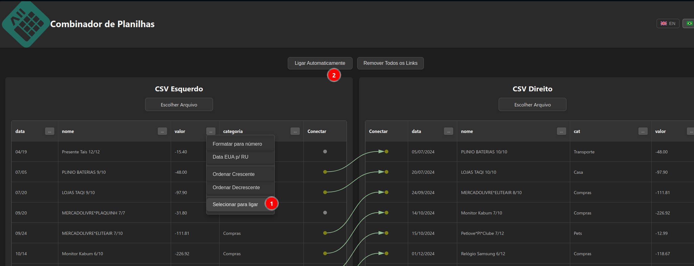

# Conector de Planilhas

Este site permite realizar a comparação manual entre 2 tabelas, ligando linhas de uma tabela à linhas de outra.

## Requisitos de Ambiente

Para garantir compatibilidade com as dependências do projeto, utilize as seguintes versões:

- **Node.js**: v16.x ou v18.x (não compatível com Node.js 22+)
- **npm**: v8.x ou v9.x

Recomenda-se o uso do [nvm](https://github.com/nvm-sh/nvm) para gerenciar versões do Node.js:

```bash
nvm install 18
nvm use 18
```

## Funcionalidades


## Tipos de Arquivo Suportados

### CSV
Arquivos de valores separados por vírgula padrão.

### OFX (Open Financial Exchange)
Arquivos OFX são automaticamente processados e convertidos para formato tabular com as seguintes colunas:

https://tales-k.github.io/spreadsheet-connector/


